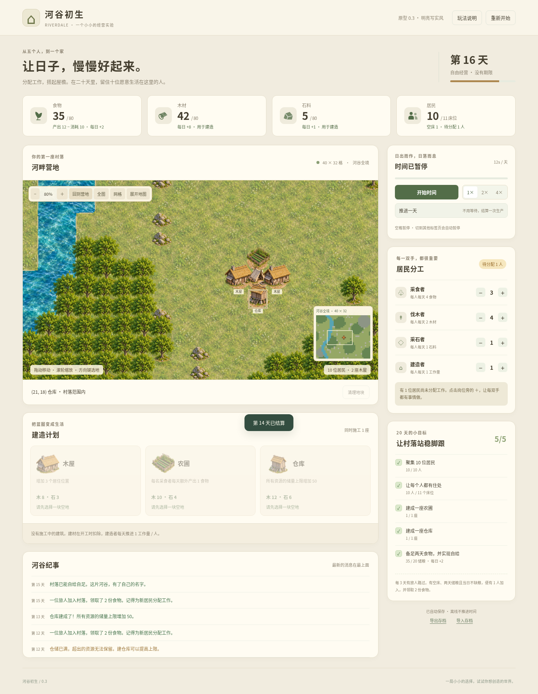
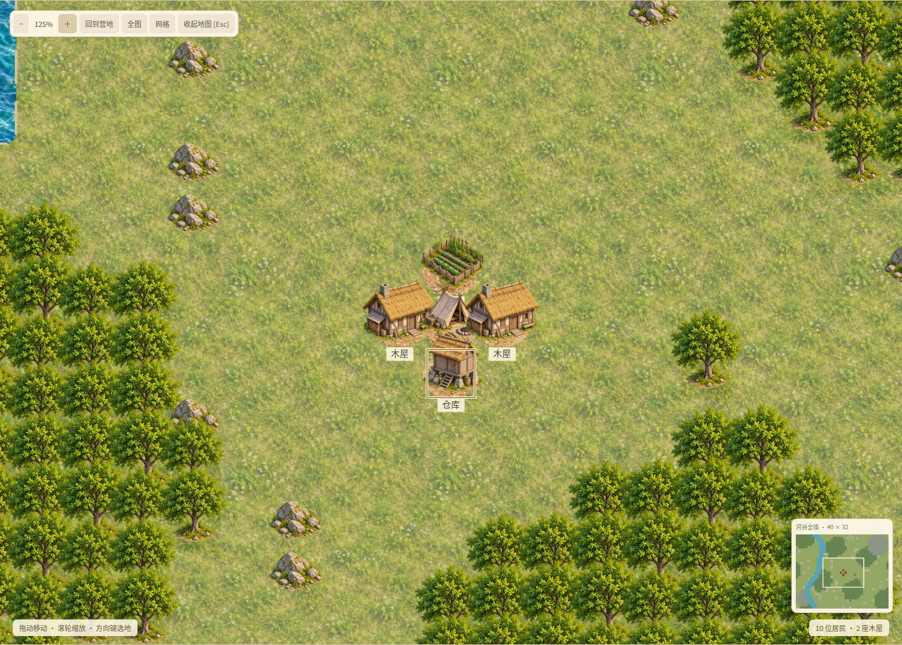
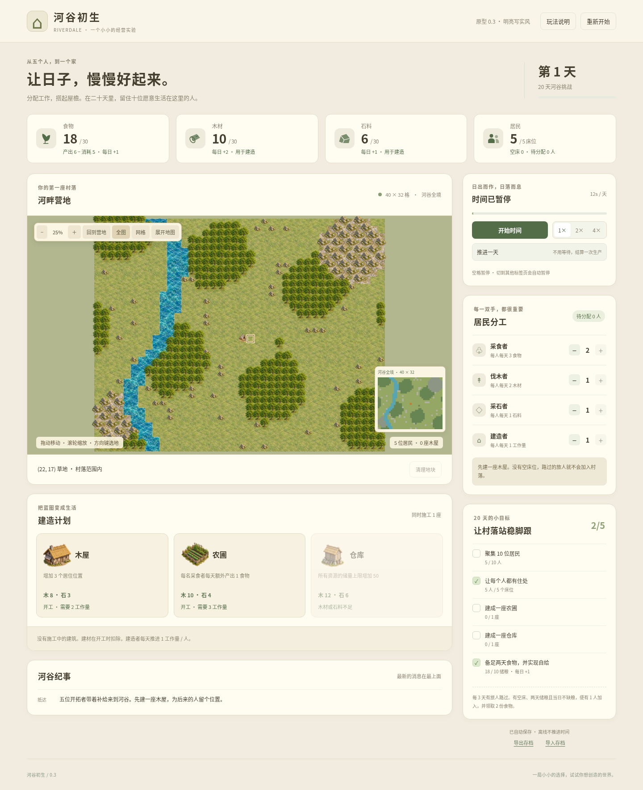

# 河谷初生 · 村落经营小游戏 0.3 · 明亮写实风

**从五位开拓者起步，在 20 天内建立一个能自给自足的十人村落。**

[下载可直接玩的 ZIP](https://github.com/2352587657/2352587657chw/raw/refs/heads/village-prototype-v0.3/downloads/riverdale-0.3.zip)

下载后右键 ZIP → **全部解压** → 双击 **河谷初生.html**。使用 Edge、Chrome 或 Firefox，不需要安装 Godot 或其他依赖。

## 0.3 明亮写实风

采用已选定的 D 风格方向：明亮的历史村落材质，茅草木屋、木仓库、农田、树木与石头采用图像素材，地面和河水使用重复纹理。地图不是概念图背景，建造和清理会实际改变对应地块。

当前是二维贴图与精灵素材版，并非可旋转的 3D 场景；河岸仍按地块组织，也没有新增村民动画或运输系统。概念图是视觉方向，不能当作实际画面承诺。

## 大地图与经营玩法

- **40 × 32 格地图**，共 1,280 格，约为旧版格数的 53 倍。
- 支持拖动、滚轮缩放、小地图定位、回营地、全图和展开地图。
- 草地、树林、石矿、河流与山地，建造受地形与扩建范围限制。
- 树林和石矿可以安排清理，农圃可直接建在普通草地。

## 你可以做什么

- 在采食、伐木、采石、建造之间分配居民。
- 在地图上选择空地，建木屋、农圃与仓库。
- 管理食物、木材、石料、床位和储量上限。
- 满足条件，迎来每三天路过一次的新居民。
- 暂停思考、手动推进一天，或选择 1 / 2 / 4 倍速自动经营。
- 达成目标获胜，或在期限与缺粮压力下重新尝试；胜利后可继续自由经营。
- 自动保存，也可以导出、导入 JSON 存档；离线不推进时间。

## 初次试玩建议

先在空地上建一座木屋，默认的 1 名建造者会在两天内完成它。留意食物的“每日净变化”，新居民到来后要手动分配工作。随后尝试修农圃、第二座木屋和仓库。

本版重点验证经营循环。没有第一人称、继承、战斗或 3D 自由建造；居民暂以岗位人数表示，没有逐人寻路。

## 项目位置

- **给玩家的单文件版**：[河谷初生.html](village-game/河谷初生.html)
- **给玩家的独立压缩包**：[riverdale-0.3.zip](downloads/riverdale-0.3.zip)
- **源代码和开发说明**：[village-game/README.md](village-game/README.md)
- **验证记录**：[village-game/VALIDATION.md](village-game/VALIDATION.md)

先前的 Godot 方块生存原型仍保留在仓库根目录，可以通过 `project.godot` 打开；旧版本见 [game-prototype-v0.3 分支](https://github.com/2352587657/2352587657chw/tree/game-prototype-v0.3)。本次小游戏独立位于 `village-game`。

0.2 请开始新局，旧版地图存档暂不兼容；仍是二维经营原型，不包含居民逐人行走和运输。

0.3 可以继续使用 0.2 / 0.2.1 的 JSON 存档。若新文件夹中找不到旧的自动存档，可以在旧版导出，再到新版导入。
