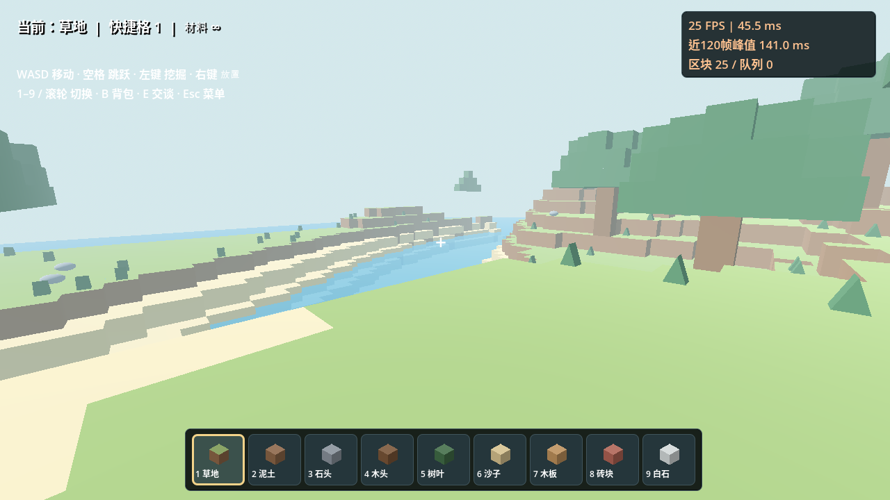
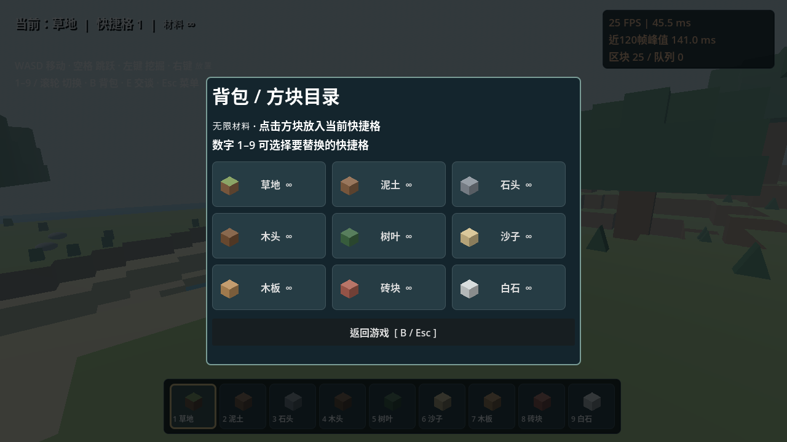

# 方野 · Blocklands 0.2

Godot 4 第一人称方块建造游戏原型，面向 Windows。无需付费素材或额外插件。



## 在 Windows 上打开新版

1. 下载本分支的 ZIP，**解压到一个新文件夹**，不要覆盖正在 Godot 中打开的旧版项目。
2. 从 https://godotengine.org/download/windows/ 下载 **Godot 4.6 标准版**（不需要 .NET 版），解压并打开。
3. 在 Godot 项目管理器点击 **导入**，选择新文件夹里的 `project.godot`，然后 **导入并编辑**。
4. 按 **F5** 运行。菜单会显示出生点准备进度，按钮可用后点击“开始 / 继续游戏”。
5. 游戏左上角显示当前材料；新版应有底部九格快捷栏、右上角 FPS，以及 B 键背包。

这是源码项目，不是 Windows EXE。若要导出，在 Godot“项目 → 导出”添加 Windows Desktop，按提示安装对应导出模板，导出到 `build/`。

## 操作

| 操作 | 按键 |
| --- | --- |
| 移动 / 观察 | WASD / 鼠标 |
| 跳跃 | 空格 |
| 挖掉瞄准的方块 | 左键，距离 6 格以内 |
| 在方块表面放置当前材料 | 右键 |
| 选择快捷格 | 数字 1–9 / 鼠标滚轮 |
| 打开 / 关闭背包 | B |
| 将背包方块放入当前快捷格 | 在背包里点击方块；数字 1–9 可先选择要替换的格子 |
| 与附近向导交谈 | E，距离 4 格以内 |
| 关闭背包 / 打开菜单 / 继续 | Esc |



## 0.2 新增

- **帧率显示**：FPS、最近 120 帧平均帧耗时与峰值、已加载区块数和等待队列。每 0.25 秒更新，峰值可以帮助发现短暂卡顿；刚启动或切换窗口时可能出现尖峰。
- **九格快捷栏**：方块图标、名称、数字编号与选中边框；新增木板、砖块、白石。
- **B 键背包**：当前为无限材料的方块目录，打开时释放鼠标并暂停角色移动、挖掘和 NPC 活动；后台地形加载继续。
- **128 × 128 格地图**：面积约为旧版的 8.5 倍，包含平原、山地、河流、树木、石头与草丛；固定种子 `42817`。河流不会真实流动，没有游泳系统。
- **区块优化**：16 × 16 格一个区块，共 64 个。只加载玩家附近最多 5 × 5 个区块的显示，近处 3 × 3 个区块建立碰撞。其他地形只保留紧凑的方块数据。
- **外露面与合并网格**：不绘制方块内部面；同材质同朝向的连续平面用 greedy meshing 合并。草丛、小石头通过 MultiMesh 批量绘制。
- **分批与后台计算**：地形数据和区块网格在单个后台工作线程计算，主线程逐个安装网格。生成任务使用数据副本与版本号，避免旧结果覆盖连续挖掘的新改动。
- **局部更新**：挖掘或放置只更新受影响区块；边界编辑同时更新贴邻区块。离开再返回，当前游戏会话内的修改保留。
- **加载保护**：出生点与附近碰撞准备好才能开始；角色不能走入尚未建立碰撞的区块，也不能走出有限地图边界。

## 建议如何试玩

1. 原地观察 FPS；转动视角，观察帧耗时是否突然增大。
2. 打开 B 背包，点击砖块，关闭背包并右键搭建；测试数字键与滚轮切换。
3. 挖掘泥土和石头，多挖几格，观察碰撞与显示是否更新。
4. 沿河谷走远，再返回自己搭建的位置，确认方块还在；观察跨区块移动时的峰值帧耗时。
5. 如果卡顿，请记录 CPU、显卡、内存、游戏窗口分辨率，以及卡顿时 FPS / 峰值 ms 和当时正在做的操作。

## 当前限制

这是测试原型，**尚无磁盘存档**：关闭游戏后，地图改动和快捷栏分配会重置。背包材料无限，挖掘暂不产生有数量的掉落物。没有工具、合成、任务、战斗和音效。

地形高度范围为 y=-8 到 39，边长有限，没有地下洞穴生成。水面仅作视觉效果。小石头和草丛是装饰，不可单独采集，挖掉支撑方块后会随区块更新消失。地形中的石头与树木方块可挖。

NPC 有简单游走、避障与一句对话，不是完整寻路；复杂地形和玩家挖出的坑可能阻挡它。区块编辑后碰撞会异步重建，繁忙时会有短暂延迟。地图数据目前全部保留在内存中；无限世界仍需进一步的数据流式加载与存档方案。

使用远程 Linux 软件渲染器检查了菜单、游戏和背包画面；不能据此保证 Windows 的帧率。截图中的 FPS 是测试机器结果。实际流畅程度请在你的电脑上测试。

## 文件结构与后续模型替换

- `scripts/voxel_world.gd`：种子地形、紧凑方块数据、区块流式显示、greedy 网格、碰撞与装饰实例。
- `scripts/player.gd`：第一人称移动、观察、碰撞与加载边界保护。
- `scripts/game.gd`：菜单、快捷栏、背包、帧率、方块交互、NPC 与自动冒烟检查。
- `scripts/block_icon.gd`：程序绘制的方块图标，可以替换成正式物品贴图。

地形数据和可视网格分离，装饰与 NPC 可替换为正式模型。方块地形目前用顶点颜色绘制，正式贴图需要为合并网格补充纹理映射规则；不是把模型文件直接放进去就会自动替换全部外观。

## 云端验证

环境已有 Godot 4.6.3，使用现有 checkout，不需要新建 worktree。

```bash
cd /workspace/2352587657chw
mkdir -p /workspace/.local/share /workspace/.local/config /workspace/.local/cache
export XDG_DATA_HOME=/workspace/.local/share
export XDG_CONFIG_HOME=/workspace/.local/config
export XDG_CACHE_HOME=/workspace/.local/cache
godot --headless --path . --editor --import --quit
timeout 150s godot --headless --path . -- --smoke-test
```

需要输出 `SMOKE PASS`、无 `CHECK FAILED` / `SCRIPT ERROR`，且退出码为 0。冒烟检查覆盖地图尺寸、合面、地面碰撞、瞄准挖掘、建造、身体重叠保护、边界更新、快速连续修改、卸载重载保留修改、快捷栏与背包按钮、NPC 对话和菜单。无窗口检查无法代替 Windows 实机操作测试。
