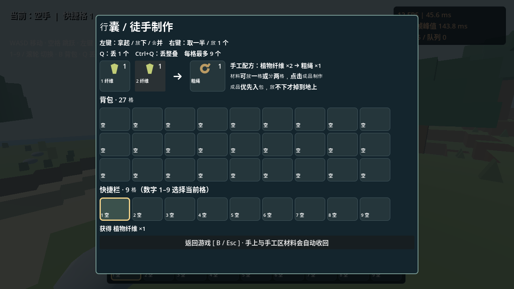

# 方野 · Blocklands 0.3

Godot 4 第一人称方块生存原型，面向 Windows。**本版取消无限材料：空手开局，物品每格最多 9 个。**


## Windows 打开方法

1. 下载 **game-prototype-v0.3** 分支 ZIP，解压到新文件夹，避免与旧版混淆。
2. 从 https://godotengine.org/download/windows/ 下载 **Godot 4.6 标准版**（不需要 .NET）。
3. 在 Godot 项目管理器点击 **导入**，选择新文件夹里的 `project.godot`，再点击 **导入并编辑**。
4. 按 **F5** 运行，等待出生点准备好，点击“开始 / 继续游戏”。菜单应显示 **原型 0.3**。

目前交付的是项目源码，不是独立 EXE。退出后仍不会保存进度。

## 建议先测试：制作第一根粗绳

1. 出生点附近有两株**浅黄色、较高的纤维植物**。准星瞄准后会显示“左键采集：植物纤维”，左键各采一次，获得 2 份纤维。
2. 按 **B** 打开背包，找到两份纤维（新拾取物品优先进入底部快捷栏）。
3. **左键**点击纤维格，拿起整叠；在手工区第一个格子**右键**放 1 个，再在第二格**左键**放下剩下的 1 个。
4. 右边出现“粗绳 ×1”的结果预览，**点击粗绳**确认制作。消耗 2 份纤维，成品自动进入背包。
5. 材料也可以整叠放在同一个手工格，每点击一次结果制作 1 根；纤维不足 2 份时不能制作。



**只预览不消耗材料；普通背包格里的相同物品放在一起只会堆叠，不会误合成。** 当前唯一配方是植物纤维 ×2 → 粗绳 ×1，粗绳还没有进一步的建筑用途。

## 背包、移动和堆叠

背包有 27 格储物区，加 9 格快捷栏，共 **36 格**。快捷栏是实际物品格，不是无限材料目录。

| 操作 | 结果 |
| --- | --- |
| 左键点击物品 | 拿起整叠，物品随鼠标移动；不需要按住拖拽 |
| 拿着物品左键点击空格 | 放下整叠 |
| 拿着物品左键点击同类物品 | 合并，上限 9；多余物品留在鼠标上 |
| 拿着物品左键点击不同物品 | 交换 |
| 空手右键点击物品 | 拿起一半，奇数向上取整 |
| 拿着物品右键点击空格 / 同类格 | 放入 1 个 |
| 点击手工区右侧成品 | 消耗一份配方，优先堆叠到背包，再找空位；全满则落在玩家附近 |
| B / Esc 关闭背包 | 鼠标上和手工区的材料自动收回；放不下则掉到附近 |

手工区右侧的成品是预览，不能用 Q 当作真实物品丢出。打开背包时角色、NPC 和地面掉落物暂停，后台地图加载继续。

## 丢弃和拾取

- **背包打开**：Q 丢弃鼠标悬停格的 **1 个**物品；如果鼠标正拿着物品，优先丢弃手上的 1 个。可作用于储物格、快捷格、手工输入格。
- **背包关闭**：Q 丢弃当前快捷栏选中的 1 个。
- **Ctrl+Q**：丢弃整叠，最多 9 个。
- Q 每次按下只触发一次，按住不连续丢弃。空格、背包背景、成品预览和暂停菜单不会凭空生成物品。
- 掉落物以小方块占位模型显示，并标注名称和数量。靠近后自动拾取，**刚丢出有 1.2 秒冷却**，避免立即捡回。
- 背包只装得下一部分时，只拾取能装下的数量，其余留在地上。暂不自动销毁掉落物，远处未加载区域中的掉落物暂停物理模拟。

## 采集与建造

| 目标 | 徒手获得 |
| --- | --- |
| 地面小石头 | 碎石 ×1 |
| 地面棕色枯枝 | 枯枝 ×1 |
| 普通绿色草丛 | 干草 ×1（暂时简化干燥过程） |
| 浅黄色高纤维植物 | 植物纤维 ×1 |
| 泥土、石头、草地、树干等方块 | 对应方块 ×1 |

用左键瞄准采集或挖掘，距离最多 6 格。**当前允许徒手挖完整石块与树干**，尚未加入工具门槛、挖掘耗时或耐久。

选择快捷栏里的方块，右键在其他方块表面放置，成功后消耗 1 个；空格不能建造。碎石、枯枝、纤维、粗绳和干草暂时属于材料，不能直接放成地形方块。木板、砖块等旧版目录物品不会再免费提供，相关配方尚未制作。

挖掉植物 / 小石头下面的支撑方块时，也会收取上面的资源。采过的资源在本次游戏内不会因区块重载而重新出现。背包满时采集所得会掉在附近，不会被静默删除。

## 其他操作

| 操作 | 按键 |
| --- | --- |
| 移动 / 观察 | WASD / 鼠标 |
| 跳跃 | 空格 |
| 快捷栏选择 | 数字 1–9 / 滚轮 |
| 打开 / 关闭背包 | B |
| 与附近向导交谈 | E |
| 关闭背包 / 暂停菜单 / 继续 | Esc |

保留 128 × 128 地图、山地与河流、NPC、右上角 FPS / 帧耗时。地形按 16×16 区块加载，外露面合并，近处才建立碰撞；地面资源仍使用 MultiMesh，不为每株植物建立独立物理体。

## 当前限制

- **没有磁盘存档**：退出游戏会重置地形、采集记录、背包、快捷栏和掉落物。
- 尚无草棚、床、工具、饥饿、口渴、陶器、战斗和音效。粗绳目前用于验证采集与合成流程。
- 固定世界种子 `42817`，地图有限，地形 y=-8 到 39，没有地下洞穴。水面只有视觉效果，没有流动或游泳。
- NPC 只有简单游走与提示，不是完整寻路。方块修改后碰撞异步重建，繁忙时可能短暂延迟。
- 本版使用即时徒手配方，尚未加入搓绳进度条或制作动画。
- 进行了 Linux 图形渲染与键鼠事件检查，尚需 Windows 实机试玩。截图里的 FPS 不代表你的电脑表现。

## 开发与验证

使用 Godot 4.6.3，无插件依赖；使用现有 checkout，不需要新建 worktree。

```bash
cd /workspace/2352587657chw
mkdir -p /workspace/.local/share /workspace/.local/config /workspace/.local/cache
export XDG_DATA_HOME=/workspace/.local/share
export XDG_CONFIG_HOME=/workspace/.local/config
export XDG_CACHE_HOME=/workspace/.local/cache
godot --headless --path . --editor --import --quit
timeout 150s godot --headless --path . -- --smoke-test
```

冒烟测试应显示 `CHECKS: 58, FAILURES: 0` 和 `SMOKE PASS`，退出码 0。覆盖数量守恒、堆叠、拆分、采集、合成、溢出落地、关闭背包、Q 丢弃、拾取冷却和部分拾取、方块消耗、区块重载。

有图形显示的 Linux 环境可运行 `godot --path . --audio-driver Dummy --script res://tests/gui_input.gd`，检查真实输入路由、悬停丢弃及成品预览保护。该测试在 `/tmp` 写入截图，成功输出 `VISUAL INPUT CHECKS COMPLETE; failures=0`。

主要模块：`item_store.gd` 管理背包数据；`game.gd` 管理 UI 与交互；`dropped_item.gd` 管理实体掉落物；`voxel_world.gd` 管理区块和地面资源。简单模型与物品图标可以继续替换。
